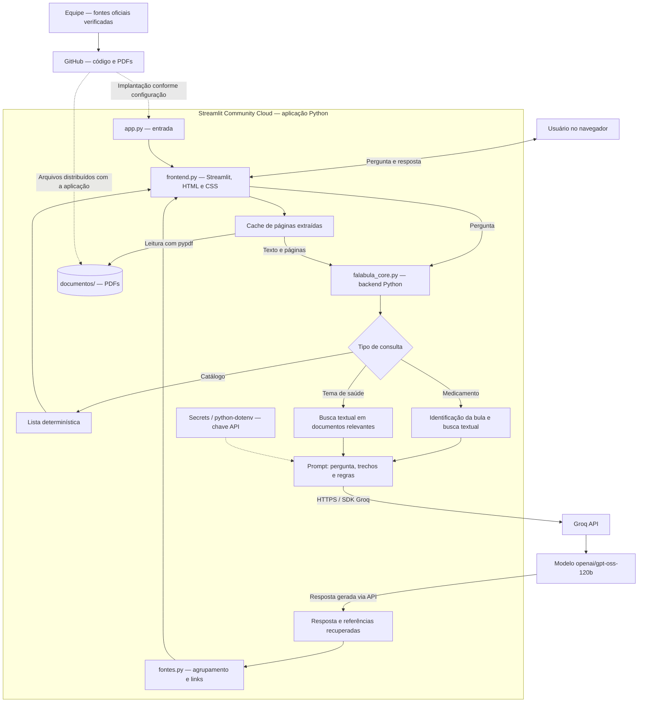

# FalaBula 2.5.0 — Arquitetura técnica

Documentação técnica da aplicação. Baseado nos arquivos da branch main: [frontend.py](../frontend.py), [falabula_core.py](../falabula_core.py), [app.py](../app.py), [requirements.txt](../requirements.txt) e [style.css](../style.css). Descreve a implementação, não uma certificação da implantação ou da qualidade clínica.

## Versão estável 2.5.0

Rodapé institucional com créditos à Equipe FalaBula e ressalva sobre direitos de terceiros. Nenhuma alteração na lógica de recuperação ou geração da versão 2.5. A versão é referência acadêmica; não representa certificação clínica.

## Atualização 2.5

O núcleo aplica uma limpeza específica dos marcadores técnicos de página na resposta gerada. As referências recuperadas permanecem separadas e são exibidas pelo frontend por meio de `fontes.py`. A limpeza não altera os trechos enviados ao modelo nem as páginas registradas.

## Atualização 2.4

O guia de diabetes foi copiado para `documentos/doencas/`. Consultas gerais com documentos gerais relevantes recuperam exclusivamente essas fontes, com até seis páginas por documento dentro do limite total de seis páginas. Bulas são alternativa quando não há correspondência em fontes gerais; consultas específicas continuam isoladas por medicamento. A validade clínica do guia deve ser conferida pela equipe.

## 1. Objetivo

O FalaBula é um chatbot acadêmico que consulta bulas e documentos de saúde em português. Emprega RAG (Retrieval-Augmented Generation, ou geração aumentada por recuperação): primeiro encontra informações na base documental, depois encaminha os trechos relevantes ao modelo de linguagem para elaborar uma resposta fundamentada. Não realiza diagnóstico ou prescrição.

## 2. Desenho da arquitetura lógica

**Leitura do desenho:** as setas contínuas representam o fluxo lógico da execução; as tracejadas representam configuração ou distribuição. O cache é administrado pelo frontend; a extração e recuperação são funções do núcleo. Frontend e backend são camadas lógicas do mesmo aplicativo Python, não serviços independentes. A API Groq é um serviço externo.

## 3. Frontend — interação com o usuário

A versão 2.3 utiliza `fontes.py` para agrupar páginas recuperadas, ordenar e deduplicar referências e gerar links para os PDFs completos no repositório oficial. A seção fica recolhida por padrão. Os links apontam para a branch main; não são garantia de versão regulatória vigente.

| Tecnologia | Papel no FalaBula | Importância |
|---|---|---|
| Python | Linguagem de frontend e backend; controla eventos e execução. | Permite integrar interface e processamento na mesma linguagem. |
| Streamlit | Framework web que renderiza formulário de acesso demonstrativo, chat, botões, menu lateral e fontes. | Reduz a necessidade de programar uma aplicação JavaScript separada. |
| HTML | Estrutura elementos personalizados, como marca e textos de apresentação, por meio de st.markdown. | Complementa os componentes nativos do Streamlit. |
| CSS | Arquivo style.css define aparência, espaçamento, cores e layout. | Melhora legibilidade e experiência de uso. |
| Estado de sessão (st.session_state) | Mantém nome do visitante, acesso demonstrativo e mensagens durante a sessão. | Preserva a conversa entre reexecuções da interface; não é autenticação real nem banco persistente. |

## 4. Backend — processamento e inteligência artificial

| Tecnologia / componente | Papel no FalaBula | Importância |
|---|---|---|
| Python | Implementa regras de consulta e integração em falabula_core.py. | Orquestra a recuperação e a geração das respostas. |
| pypdf | Extrai texto dos PDFs por página. | Transforma documentos em conteúdo pesquisável e permite indicar páginas de origem. |
| pathlib, re, unicodedata, collections | Bibliotecas padrão para arquivos, normalização de texto, expressões regulares e contagem. | Permitem localizar documentos e termos sem dependências pesadas. |
| RAG | Estratégia que combina recuperação documental e geração de texto. | Restringe o contexto entregue à IA e melhora a rastreabilidade; não elimina erros. |
| Recuperação lexical | Identifica nomes/aliases de medicamentos; pontua páginas por termos e âncoras; consultas gerais priorizam documentos de saúde. | Seleciona contexto relevante sem embeddings ou banco vetorial. |
| Cache do Streamlit (st.cache_resource) | Reutiliza páginas extraídas; chave varia com caminho, tamanho e data de modificação dos PDFs. | Evita reler toda a base em cada consulta; atualiza quando arquivos mudam. |
| SDK Groq (pacote groq) | Envia pergunta, instruções e trechos recuperados à API de inferência. | Integra o sistema ao modelo externo sem hospedar o LLM localmente. |
| GPT-OSS-120B (openai/gpt-oss-120b) | Modelo de linguagem configurado na chamada à API Groq. | Interpreta o contexto e redige respostas em português. Não é treinado pelo projeto. |
| python-dotenv / Streamlit Secrets | Carrega GROQ_API_KEY do .env local ou dos segredos da hospedagem. | Evita incluir credenciais diretamente no código público. |
| PDFs | Base documental armazenada em documentos/ e subpastas. | Fonte de conhecimento consultada; cobertura e qualidade dependem dos documentos cadastrados. |

## 5. Infraestrutura, desenvolvimento e testes

| Tecnologia | Papel e importância |
|---|---|
| Git e GitHub | Versionamento, histórico de alterações, colaboração, backup e distribuição do código e dos PDFs. |
| Streamlit Community Cloud | Hospeda e executa a aplicação Python, disponibilizando uma URL web. A branch e o arquivo de entrada precisam estar corretamente configurados. |
| requirements.txt e pip | Declaram e instalam dependências: streamlit, python-dotenv, pypdf e groq. |
| unittest | Framework padrão Python para testes de regressão das regras de recuperação, catálogo e ausência de evidência. Testes cadastrados não equivalem a testes executados. |
| Google Drive | Pasta compartilhada de apoio à coleta documental. Não é consultada automaticamente pelo chatbot; PDFs devem ser enviados ao GitHub. |

## 6. Como uma pergunta vira resposta

1. O visitante abre o aplicativo; app.py importa frontend.py quando usado como entrada.
2. O Streamlit recebe a pergunta e verifica a lista de PDFs em documentos/.
3. Se for uma consulta de catálogo, o sistema lista as bulas diretamente, sem chamar a IA.
4. Caso contrário, carrega ou reutiliza o texto das páginas. Identifica o medicamento por nome/alias; se não houver medicamento identificado, tenta recuperar informações gerais relevantes, respeitando regras de segurança.
5. A recuperação seleciona até quatro páginas na consulta específica ou até seis na consulta geral, com trechos limitados em tamanho. Se não houver evidência, informa a limitação.
6. O backend monta o prompt com pergunta, trechos, nomes de arquivos, páginas e regras de segurança. Envia pela API Groq ao modelo GPT-OSS-120B.
7. A resposta retorna ao Streamlit, que mostra o texto e, quando disponíveis, os documentos e páginas recuperados. A pessoa deve conferir as fontes originais.

## 7. Referências técnicas

- [Python](https://docs.python.org/3/)
- [Streamlit](https://docs.streamlit.io/)
- [pypdf](https://pypdf.readthedocs.io/)
- [Groq API](https://console.groq.com/docs/overview)
- [Modelo GPT-OSS-120B](https://huggingface.co/openai/gpt-oss-120b)
- [python-dotenv](https://pypi.org/project/python-dotenv/)
- [GitHub](https://docs.github.com/)
- [MDN — HTML e CSS](https://developer.mozilla.org/pt-BR/)

A descrição do projeto foi fundamentada no código do próprio repositório. As referências externas servem para aprofundamento dos conceitos.

## 8. Integração das tecnologias

### Do navegador ao servidor
O navegador apresenta a interface gerada pelo Streamlit. O código Python roda no servidor, não no navegador. O Streamlit comunica eventos da interface ao processo Python e atualiza os componentes; não foi necessário desenvolver um frontend React nem uma API REST própria. HTML e CSS personalizam a apresentação, mas não executam a lógica do RAG. O estado de sessão preserva mensagens entre reexecuções; não constitui memória clínica persistente e o histórico não é enviado automaticamente ao modelo na implementação atual.

### Do arquivo à informação pesquisável
pathlib percorre a pasta documentos/ e subpastas. pypdf extrai texto por página. O cache do Streamlit armazena a estrutura de páginas extraídas; a assinatura por caminho, tamanho e data de modificação permite reconhecer alterações. re e unicodedata normalizam maiúsculas, acentos e pontuação. O catálogo associa nomes de medicamentos a aliases conhecidos; para novas bulas, o nome do arquivo é a referência inicial. A recuperação lexical pontua a presença de termos e âncoras de seções, como contraindicações. Para consultas gerais, documentos de doenças e protocolos recebem prioridade. Não há embeddings, banco vetorial nem treinamento de modelo. A escolha simplifica a execução e reduz uso de memória, mas limita a capacidade de reconhecer sinônimos e relações semânticas.

### Da recuperação à geração
O backend escolhe até quatro páginas de uma bula específica ou até seis páginas em consulta geral, limitando cada trecho a 4.200 caracteres. O prompt contém pergunta, trechos, documento e página, além de instruções para não inventar informações e não prescrever. O SDK Groq envia a solicitação ao serviço remoto por HTTPS, usando a chave privada. O modelo openai/gpt-oss-120b gera texto; temperatura zero reduz variabilidade, sem garantir determinismo ou precisão. O Streamlit mostra a resposta e as páginas recuperadas. Se não houver evidência, o sistema deve explicitar a limitação. Catálogos são produzidos pelo código sem depender do modelo. A presença de um trecho não prova que ele sustenta toda a resposta.

### Da manutenção à publicação
Git registra versões; GitHub armazena código e PDFs; Streamlit Community Cloud instala dependências declaradas em requirements.txt e executa o arquivo de entrada configurado. O Drive é apenas uma área de coleta. Alterar o Drive não altera o repositório. A equipe deve verificar origem, versão e legibilidade dos documentos, enviar os PDFs ao GitHub e conferir a implantação. A chave GROQ_API_KEY fica no .env local ou nos Secrets do servidor, nunca em código público. O projeto não possui login real, banco de usuários ou garantia de confidencialidade clínica. Não inserir dados pessoais de saúde.

