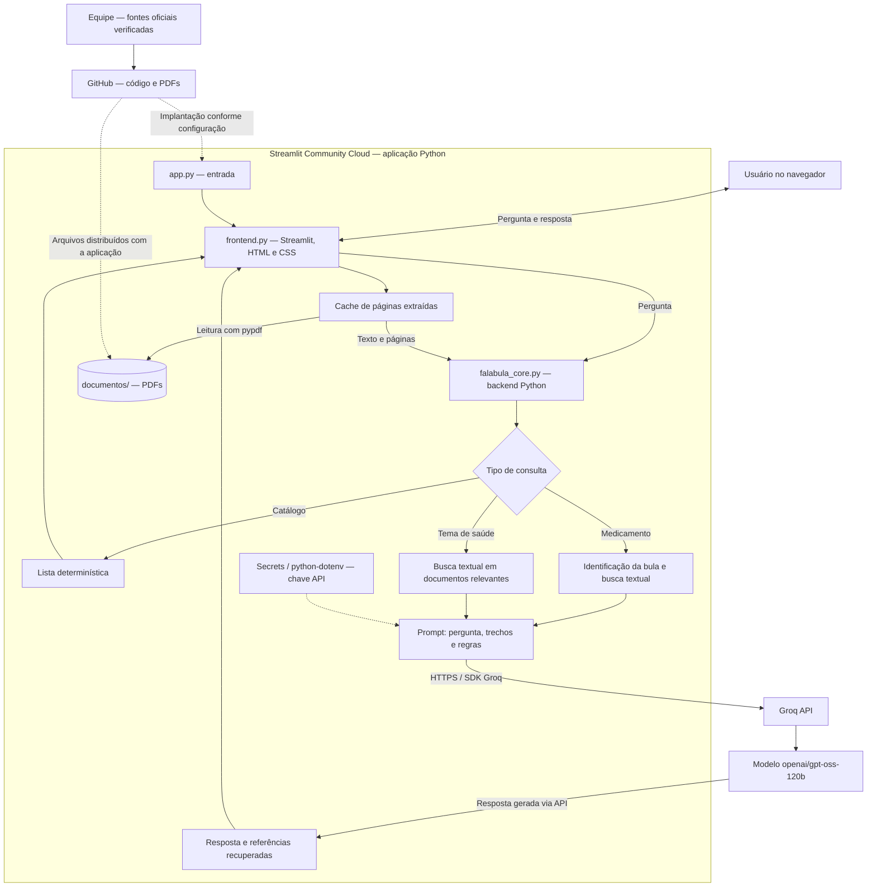

# FalaBula 2.2 — Arquitetura e guia de estudo para apresentação

Material de apoio à equipe acadêmica. Baseado nos arquivos da branch main: [frontend.py](../frontend.py), [falabula_core.py](../falabula_core.py), [app.py](../app.py), [requirements.txt](../requirements.txt) e [style.css](../style.css). Descreve a implementação, não uma certificação da implantação ou da qualidade clínica.

## 1. Objetivo

O FalaBula é um chatbot acadêmico que consulta bulas e documentos de saúde em português. Emprega RAG (Retrieval-Augmented Generation, ou geração aumentada por recuperação): primeiro encontra informações na base documental, depois encaminha os trechos relevantes ao modelo de linguagem para elaborar uma resposta fundamentada. Não realiza diagnóstico ou prescrição.

## 2. Desenho da arquitetura lógica

**Leitura do desenho:** as setas contínuas representam o fluxo lógico da execução; as tracejadas representam configuração ou distribuição. O cache é administrado pelo frontend; a extração e recuperação são funções do núcleo. Frontend e backend são camadas lógicas do mesmo aplicativo Python, não serviços independentes. A API Groq é um serviço externo.

## 3. Frontend — interação com o usuário

| Tecnologia | Papel no FalaBula | Importância |
|---|---|---|
| Python | Linguagem de frontend e backend; controla eventos e execução. | Permite integrar interface e processamento na mesma linguagem. |
| Streamlit | Framework web que renderiza formulário de acesso demonstrativo, chat, botões, menu lateral e fontes. | Reduz a necessidade de programar uma aplicação JavaScript separada. |
| HTML | Estrutura elementos personalizados, como marca e textos de apresentação, por meio de st.markdown. | Complementa os componentes nativos do Streamlit. |
| CSS | Arquivo style.css define aparência, espaçamento, cores e layout. | Melhora legibilidade e experiência de uso. |
| Estado de sessão (st.session_state) | Mantém nome do visitante, acesso demonstrativo e mensagens durante a sessão. | Preserva a conversa entre reexecuções da interface; não é autenticação real nem banco persistente. |

## 4. Backend — processamento e inteligência artificial

| Tecnologia / componente | Papel no FalaBula | Importância |
|---|---|---|
| Python | Implementa regras de consulta e integração em falabula_core.py. | Orquestra a recuperação e a geração das respostas. |
| pypdf | Extrai texto dos PDFs por página. | Transforma documentos em conteúdo pesquisável e permite indicar páginas de origem. |
| pathlib, re, unicodedata, collections | Bibliotecas padrão para arquivos, normalização de texto, expressões regulares e contagem. | Permitem localizar documentos e termos sem dependências pesadas. |
| RAG | Estratégia que combina recuperação documental e geração de texto. | Restringe o contexto entregue à IA e melhora a rastreabilidade; não elimina erros. |
| Recuperação lexical | Identifica nomes/aliases de medicamentos; pontua páginas por termos e âncoras; consultas gerais priorizam documentos de saúde. | Seleciona contexto relevante sem embeddings ou banco vetorial. |
| Cache do Streamlit (st.cache_resource) | Reutiliza páginas extraídas; chave varia com caminho, tamanho e data de modificação dos PDFs. | Evita reler toda a base em cada consulta; atualiza quando arquivos mudam. |
| SDK Groq (pacote groq) | Envia pergunta, instruções e trechos recuperados à API de inferência. | Integra o sistema ao modelo externo sem hospedar o LLM localmente. |
| GPT-OSS-120B (openai/gpt-oss-120b) | Modelo de linguagem configurado na chamada à API Groq. | Interpreta o contexto e redige respostas em português. Não é treinado pelo projeto. |
| python-dotenv / Streamlit Secrets | Carrega GROQ_API_KEY do .env local ou dos segredos da hospedagem. | Evita incluir credenciais diretamente no código público. |
| PDFs | Base documental armazenada em documentos/ e subpastas. | Fonte de conhecimento consultada; cobertura e qualidade dependem dos documentos cadastrados. |

## 5. Infraestrutura, desenvolvimento e testes

| Tecnologia | Papel e importância |
|---|---|
| Git e GitHub | Versionamento, histórico de alterações, colaboração, backup e distribuição do código e dos PDFs. |
| Streamlit Community Cloud | Hospeda e executa a aplicação Python, disponibilizando uma URL web. A branch e o arquivo de entrada precisam estar corretamente configurados. |
| requirements.txt e pip | Declaram e instalam dependências: streamlit, python-dotenv, pypdf e groq. |
| unittest | Framework padrão Python para testes de regressão das regras de recuperação, catálogo e ausência de evidência. Testes cadastrados não equivalem a testes executados. |
| Google Drive | Pasta compartilhada de apoio à coleta documental. Não é consultada automaticamente pelo chatbot; PDFs devem ser enviados ao GitHub. |

## 6. Como uma pergunta vira resposta

1. O visitante abre o aplicativo; app.py importa frontend.py quando usado como entrada.
2. O Streamlit recebe a pergunta e verifica a lista de PDFs em documentos/.
3. Se for uma consulta de catálogo, o sistema lista as bulas diretamente, sem chamar a IA.
4. Caso contrário, carrega ou reutiliza o texto das páginas. Identifica o medicamento por nome/alias; se não houver medicamento identificado, tenta recuperar informações gerais relevantes, respeitando regras de segurança.
5. A recuperação seleciona até quatro páginas na consulta específica ou até seis na consulta geral, com trechos limitados em tamanho. Se não houver evidência, informa a limitação.
6. O backend monta o prompt com pergunta, trechos, nomes de arquivos, páginas e regras de segurança. Envia pela API Groq ao modelo GPT-OSS-120B.
7. A resposta retorna ao Streamlit, que mostra o texto e, quando disponíveis, os documentos e páginas recuperados. A pessoa deve conferir as fontes originais.

## 7. Conceitos que o grupo precisa saber explicar

- **Frontend x backend:** interface visível versus processamento e regras. Aqui compartilham o mesmo processo Python; não existe API REST própria entre os dois.
- **API:** contrato de comunicação com um serviço. Groq fornece inferência; GPT-OSS-120B é o modelo, não o framework web.
- **LLM:** modelo de linguagem que produz texto a partir de um contexto. Não possui garantia de verdade.
- **RAG x treinamento:** RAG recupera conteúdo na hora da pergunta; adicionar um PDF não altera os pesos do modelo.
- **Busca lexical x embeddings:** a versão atual usa correspondência textual e pontuação, não vetores semânticos, FAISS ou ChromaDB.
- **Banco de dados:** nesta versão a base é documental em arquivos PDF, com páginas extraídas em memória. Não há banco relacional ou vetorial dedicado.
- **Segurança:** chave privada no servidor; acesso demonstrativo não autentica usuários. Não inserir dados pessoais ou clínicos identificáveis. As perguntas e trechos selecionados podem ser enviados ao provedor externo.
- **Limitações:** PDFs sem texto extraível podem interromper a leitura; aliases de novas bulas podem exigir ajuste; documentos gerais precisam ser cadastrados para cobrir doenças; recuperação e geração podem falhar. A seção de fontes mostra páginas recuperadas, não comprova automaticamente cada afirmação.
- **Homologação:** confirmar versão no menu lateral, verificar implantação, executar testes e comparar respostas com documentos. Não confundir código publicado com aplicação aprovada.

## 8. Roteiro sugerido para apresentação (5 a 7 minutos)

| Tempo | Tema | Fala sugerida |
|---|---|---|
| 1 min | Problema e objetivo | Criamos um assistente acadêmico que facilita a consulta a bulas e documentos de saúde, sem substituir orientação profissional. |
| 1 min | Frontend | Usamos Python e Streamlit para a interface, com HTML e CSS para personalização. |
| 2 min | Backend e RAG | O núcleo localiza documentos, extrai páginas e seleciona trechos. Somente então envia contexto à API Groq, que executa o modelo GPT-OSS-120B. |
| 1 min | Infraestrutura | O GitHub mantém código e documentos; Streamlit Community Cloud disponibiliza o aplicativo. |
| 1–2 min | Demonstração e limitações | Mostrar catálogo, consulta de medicamento, pergunta geral e referências. Explicar que a qualidade depende da base e que não há prescrição. |

## 9. Referências técnicas

- [Python](https://docs.python.org/3/)
- [Streamlit](https://docs.streamlit.io/)
- [pypdf](https://pypdf.readthedocs.io/)
- [Groq API](https://console.groq.com/docs/overview)
- [Modelo GPT-OSS-120B](https://huggingface.co/openai/gpt-oss-120b)
- [python-dotenv](https://pypi.org/project/python-dotenv/)
- [GitHub](https://docs.github.com/)
- [MDN — HTML e CSS](https://developer.mozilla.org/pt-BR/)

A descrição do projeto foi fundamentada no código do próprio repositório. As referências externas servem para aprofundamento dos conceitos.

## 10. Estudo aprofundado: integração das tecnologias

### Do navegador ao servidor
O navegador apresenta a interface gerada pelo Streamlit. O código Python roda no servidor, não no navegador. O Streamlit comunica eventos da interface ao processo Python e atualiza os componentes; não foi necessário desenvolver um frontend React nem uma API REST própria. HTML e CSS personalizam a apresentação, mas não executam a lógica do RAG. O estado de sessão preserva mensagens entre reexecuções; não constitui memória clínica persistente e o histórico não é enviado automaticamente ao modelo na implementação atual.

### Do arquivo à informação pesquisável
pathlib percorre a pasta documentos/ e subpastas. pypdf extrai texto por página. O cache do Streamlit armazena a estrutura de páginas extraídas; a assinatura por caminho, tamanho e data de modificação permite reconhecer alterações. re e unicodedata normalizam maiúsculas, acentos e pontuação. O catálogo associa nomes de medicamentos a aliases conhecidos; para novas bulas, o nome do arquivo é a referência inicial. A recuperação lexical pontua a presença de termos e âncoras de seções, como contraindicações. Para consultas gerais, documentos de doenças e protocolos recebem prioridade. Não há embeddings, banco vetorial nem treinamento de modelo. A escolha simplifica a execução e reduz uso de memória, mas limita a capacidade de reconhecer sinônimos e relações semânticas.

### Da recuperação à geração
O backend escolhe até quatro páginas de uma bula específica ou até seis páginas em consulta geral, limitando cada trecho a 4.200 caracteres. O prompt contém pergunta, trechos, documento e página, além de instruções para não inventar informações e não prescrever. O SDK Groq envia a solicitação ao serviço remoto por HTTPS, usando a chave privada. O modelo openai/gpt-oss-120b gera texto; temperatura zero reduz variabilidade, sem garantir determinismo ou precisão. O Streamlit mostra a resposta e as páginas recuperadas. Se não houver evidência, o sistema deve explicitar a limitação. Catálogos são produzidos pelo código sem depender do modelo. A presença de um trecho não prova que ele sustenta toda a resposta.

### Da manutenção à publicação
Git registra versões; GitHub armazena código e PDFs; Streamlit Community Cloud instala dependências declaradas em requirements.txt e executa o arquivo de entrada configurado. O Drive é apenas uma área de coleta. Alterar o Drive não altera o repositório. A equipe deve verificar origem, versão e legibilidade dos documentos, enviar os PDFs ao GitHub e conferir a implantação. A chave GROQ_API_KEY fica no .env local ou nos Secrets do servidor, nunca em código público. O projeto não possui login real, banco de usuários ou garantia de confidencialidade clínica. Não inserir dados pessoais de saúde.

## 11. Banco de perguntas para a banca

| Pergunta | Resposta a estudar |
|---|---|
| Por que Python? | Integra interface, tratamento de documentos e SDK de IA em uma linguagem acessível à equipe. |
| Por que Streamlit em vez de React? | Para reduzir complexidade de desenvolvimento e manter a interface no ecossistema Python; React permitiria maior controle visual, com custo de integração adicional. |
| O frontend roda no navegador? | A interface é exibida no navegador, mas o código Python roda no servidor Streamlit. |
| Front e back são serviços separados? | Não. São camadas lógicas do mesmo processo, ligadas por chamadas de funções. |
| Qual a função de app.py? | É um ponto de entrada que importa frontend.py; não precisa duplicar a lógica. |
| HTML e CSS fazem a mesma coisa? | HTML estrutura elementos; CSS controla a aparência. |
| O que é uma API? | Uma interface de comunicação entre sistemas; aqui o SDK Groq faz solicitações ao serviço remoto. |
| Groq é o modelo? | Não. Groq é o provedor de inferência; GPT-OSS-120B é o modelo configurado. |
| O que significa LLM? | Large Language Model, um modelo de linguagem de grande porte. |
| O que é inferência? | Execução de um modelo já treinado para produzir uma saída com base na entrada. |
| O que é RAG? | Recuperar informações externas e fornecê-las como contexto ao modelo antes de gerar uma resposta. |
| Por que RAG e não fine-tuning? | Para ampliar e atualizar a base documental sem modificar os pesos do modelo. |
| Por que pypdf? | Extrai texto por página diretamente de PDFs textuais, permitindo recuperação e referências. |
| Um PDF escaneado funciona? | Não necessariamente: sem camada de texto, exige preparação ou OCR externo. |
| Qual o algoritmo de busca? | Correspondência lexical, aliases e pontuação por termos e âncoras; não é busca vetorial. |
| O que são embeddings? | Vetores numéricos que representam conteúdo; não são usados nesta versão. |
| Existe banco de dados? | Não há SGBD dedicado; PDFs são a base persistente e páginas extraídas ficam em memória/cache. |
| Por que cache? | Evita repetir a extração em cada pergunta, economizando tempo e recursos. |
| Como o cache percebe mudanças? | A assinatura dos arquivos muda quando caminho, tamanho ou data de modificação mudam. |
| Como o chatbot encontra uma nova bula? | Pelo nome do arquivo; aliases adicionais podem exigir alteração do catálogo. |
| Como responde a perguntas gerais? | Busca termos relevantes nos documentos, prioriza fontes gerais e informa limites de cobertura. |
| Pode responder sobre qualquer doença? | Não. Depende de conteúdo disponível e recuperado na base. |
| Qual o papel do prompt? | Informar tarefa, contexto, referências e restrições ao modelo. |
| Temperatura zero impede alucinações? | Não. Reduz variabilidade, mas não garante factualidade. |
| Como validar uma resposta? | Comparar afirmações com as páginas originais, verificar relevância, completude e ausência de invenções. |
| O que acontece se a Groq falhar? | Consultas dependentes do modelo podem falhar; catálogo local não precisa da API. |
| Como proteger a chave? | Variáveis de ambiente e Secrets, sem publicar a credencial. |
| O login é seguro? | É demonstrativo, sem autenticação real; não usar para dados clínicos pessoais. |
| O histórico é memória do modelo? | Não. O estado de sessão exibe mensagens; o núcleo recebe a pergunta atual e os trechos, não todo o histórico. |
| Por que GitHub e Streamlit Cloud? | Versionamento e colaboração, associados à hospedagem do protótipo. |
| O Drive sincroniza automaticamente? | Não, os PDFs precisam entrar no repositório e na implantação. |
| Como comprovar funcionamento? | Executar regressão, confirmar a versão publicada e homologar consultas com fontes conhecidas. |
| Como medir a qualidade do RAG? | Usar perguntas com respostas de referência e medir recuperação relevante, fidelidade, completude e recusas adequadas. |
| O que melhoraria no futuro? | Busca híbrida, metadados, controle de versões documentais, testes de segurança e autenticação, conforme necessidade. |
| O sistema substitui médico ou farmacêutico? | Não; finalidade acadêmica e informativa, sem diagnóstico ou prescrição. |

## 12. Plano de preparação do grupo

1. Todos: explicar o fluxo completo sem ler o código; distinguir modelo, API, framework e RAG.
2. Responsável pelo frontend: localizar app.py, frontend.py, style.css e explicar sessão e reexecução.
3. Responsável pelo backend: localizar listar_arquivos, carregar_paginas, identificar_documentos, recuperar_paginas e responder_pergunta; explicar a consulta geral e específica.
4. Responsável pela IA: explicar prompt, inferência, limites e por que RAG não é treinamento.
5. Responsável pela infraestrutura: mostrar GitHub, requirements.txt, Secrets sem exibir chaves e processo de implantação.
6. Todos: ensaiar demonstração com catálogo, medicamento conhecido, pergunta geral, tema ausente e pedido de prescrição. Conferir as fontes originais e registrar falhas. Não apresentar métricas não medidas ou testes não executados como resultados.
