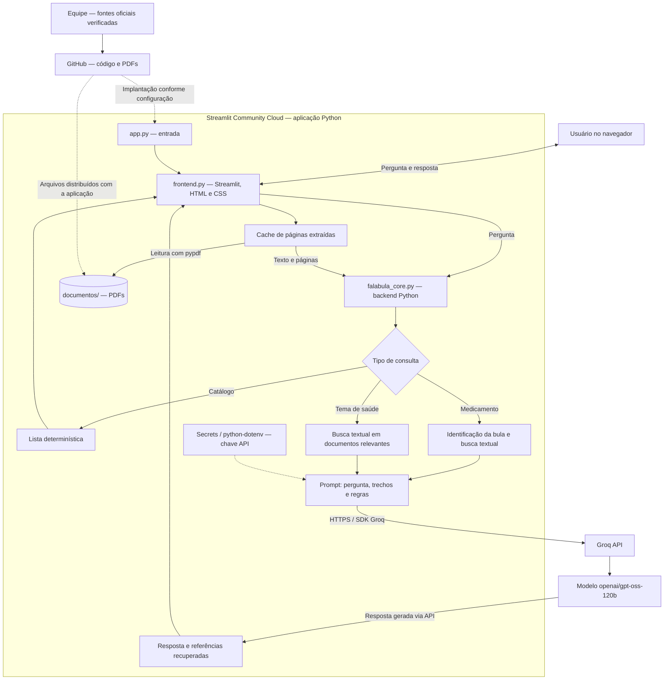

# FalaBula 2.2 — Arquitetura e guia de estudo para apresentação

Material de apoio à equipe acadêmica. Baseado nos arquivos da branch main: [frontend.py](../frontend.py), [falabula_core.py](../falabula_core.py), [app.py](../app.py), [requirements.txt](../requirements.txt) e [style.css](../style.css). Descreve a implementação, não uma certificação da implantação ou da qualidade clínica.

## 1. Objetivo

O FalaBula é um chatbot acadêmico que consulta bulas e documentos de saúde em português. Emprega RAG (Retrieval-Augmented Generation, ou geração aumentada por recuperação): primeiro encontra informações na base documental, depois encaminha os trechos relevantes ao modelo de linguagem para elaborar uma resposta fundamentada. Não realiza diagnóstico ou prescrição.

## 2. Desenho da arquitetura lógica

**Leitura do desenho:** as setas contínuas representam o fluxo lógico da execução; as tracejadas representam configuração ou distribuição. O cache é administrado pelo frontend; a extração e recuperação são funções do núcleo. Frontend e backend são camadas lógicas do mesmo aplicativo Python, não serviços independentes. A API Groq é um serviço externo.

## 3. Frontend — interação com o usuário

| Tecnologia | Papel no FalaBula | Importância |
|---|---|---|
| Python | Linguagem de frontend e backend; controla eventos e execução. | Permite integrar interface e processamento na mesma linguagem. |
| Streamlit | Framework web que renderiza formulário de acesso demonstrativo, chat, botões, menu lateral e fontes. | Reduz a necessidade de programar uma aplicação JavaScript separada. |
| HTML | Estrutura elementos personalizados, como marca e textos de apresentação, por meio de st.markdown. | Complementa os componentes nativos do Streamlit. |
| CSS | Arquivo style.css define aparência, espaçamento, cores e layout. | Melhora legibilidade e experiência de uso. |
| Estado de sessão (st.session_state) | Mantém nome do visitante, acesso demonstrativo e mensagens durante a sessão. | Preserva a conversa entre reexecuções da interface; não é autenticação real nem banco persistente. |

## 4. Backend — processamento e inteligência artificial

| Tecnologia / componente | Papel no FalaBula | Importância |
|---|---|---|
| Python | Implementa regras de consulta e integração em falabula_core.py. | Orquestra a recuperação e a geração das respostas. |
| pypdf | Extrai texto dos PDFs por página. | Transforma documentos em conteúdo pesquisável e permite indicar páginas de origem. |
| pathlib, re, unicodedata, collections | Bibliotecas padrão para arquivos, normalização de texto, expressões regulares e contagem. | Permitem localizar documentos e termos sem dependências pesadas. |
| RAG | Estratégia que combina recuperação documental e geração de texto. | Restringe o contexto entregue à IA e melhora a rastreabilidade; não elimina erros. |
| Recuperação lexical | Identifica nomes/aliases de medicamentos; pontua páginas por termos e âncoras; consultas gerais priorizam documentos de saúde. | Seleciona contexto relevante sem embeddings ou banco vetorial. |
| Cache do Streamlit (st.cache_resource) | Reutiliza páginas extraídas; chave varia com caminho, tamanho e data de modificação dos PDFs. | Evita reler toda a base em cada consulta; atualiza quando arquivos mudam. |
| SDK Groq (pacote groq) | Envia pergunta, instruções e trechos recuperados à API de inferência. | Integra o sistema ao modelo externo sem hospedar o LLM localmente. |
| GPT-OSS-120B (openai/gpt-oss-120b) | Modelo de linguagem configurado na chamada à API Groq. | Interpreta o contexto e redige respostas em português. Não é treinado pelo projeto. |
| python-dotenv / Streamlit Secrets | Carrega GROQ_API_KEY do .env local ou dos segredos da hospedagem. | Evita incluir credenciais diretamente no código público. |
| PDFs | Base documental armazenada em documentos/ e subpastas. | Fonte de conhecimento consultada; cobertura e qualidade dependem dos documentos cadastrados. |

## 5. Infraestrutura, desenvolvimento e testes

| Tecnologia | Papel e importância |
|---|---|
| Git e GitHub | Versionamento, histórico de alterações, colaboração, backup e distribuição do código e dos PDFs. |
| Streamlit Community Cloud | Hospeda e executa a aplicação Python, disponibilizando uma URL web. A branch e o arquivo de entrada precisam estar corretamente configurados. |
| requirements.txt e pip | Declaram e instalam dependências: streamlit, python-dotenv, pypdf e groq. |
| unittest | Framework padrão Python para testes de regressão das regras de recuperação, catálogo e ausência de evidência. Testes cadastrados não equivalem a testes executados. |
| Google Drive | Pasta compartilhada de apoio à coleta documental. Não é consultada automaticamente pelo chatbot; PDFs devem ser enviados ao GitHub. |

## 6. Como uma pergunta vira resposta

1. O visitante abre o aplicativo; app.py importa frontend.py quando usado como entrada.
2. O Streamlit recebe a pergunta e verifica a lista de PDFs em documentos/.
3. Se for uma consulta de catálogo, o sistema lista as bulas diretamente, sem chamar a IA.
4. Caso contrário, carrega ou reutiliza o texto das páginas. Identifica o medicamento por nome/alias; se não houver medicamento identificado, tenta recuperar informações gerais relevantes, respeitando regras de segurança.
5. A recuperação seleciona até quatro páginas na consulta específica ou até seis na consulta geral, com trechos limitados em tamanho. Se não houver evidência, informa a limitação.
6. O backend monta o prompt com pergunta, trechos, nomes de arquivos, páginas e regras de segurança. Envia pela API Groq ao modelo GPT-OSS-120B.
7. A resposta retorna ao Streamlit, que mostra o texto e, quando disponíveis, os documentos e páginas recuperados. A pessoa deve conferir as fontes originais.

## 7. Conceitos que o grupo precisa saber explicar

- **Frontend x backend:** interface visível versus processamento e regras. Aqui compartilham o mesmo processo Python; não existe API REST própria entre os dois.
- **API:** contrato de comunicação com um serviço. Groq fornece inferência; GPT-OSS-120B é o modelo, não o framework web.
- **LLM:** modelo de linguagem que produz texto a partir de um contexto. Não possui garantia de verdade.
- **RAG x treinamento:** RAG recupera conteúdo na hora da pergunta; adicionar um PDF não altera os pesos do modelo.
- **Busca lexical x embeddings:** a versão atual usa correspondência textual e pontuação, não vetores semânticos, FAISS ou ChromaDB.
- **Banco de dados:** nesta versão a base é documental em arquivos PDF, com páginas extraídas em memória. Não há banco relacional ou vetorial dedicado.
- **Segurança:** chave privada no servidor; acesso demonstrativo não autentica usuários. Não inserir dados pessoais ou clínicos identificáveis. As perguntas e trechos selecionados podem ser enviados ao provedor externo.
- **Limitações:** PDFs sem texto extraível podem interromper a leitura; aliases de novas bulas podem exigir ajuste; documentos gerais precisam ser cadastrados para cobrir doenças; recuperação e geração podem falhar. A seção de fontes mostra páginas recuperadas, não comprova automaticamente cada afirmação.
- **Homologação:** confirmar versão no menu lateral, verificar implantação, executar testes e comparar respostas com documentos. Não confundir código publicado com aplicação aprovada.

## 8. Roteiro sugerido para apresentação (5 a 7 minutos)

| Tempo | Tema | Fala sugerida |
|---|---|---|
| 1 min | Problema e objetivo | Criamos um assistente acadêmico que facilita a consulta a bulas e documentos de saúde, sem substituir orientação profissional. |
| 1 min | Frontend | Usamos Python e Streamlit para a interface, com HTML e CSS para personalização. |
| 2 min | Backend e RAG | O núcleo localiza documentos, extrai páginas e seleciona trechos. Somente então envia contexto à API Groq, que executa o modelo GPT-OSS-120B. |
| 1 min | Infraestrutura | O GitHub mantém código e documentos; Streamlit Community Cloud disponibiliza o aplicativo. |
| 1–2 min | Demonstração e limitações | Mostrar catálogo, consulta de medicamento, pergunta geral e referências. Explicar que a qualidade depende da base e que não há prescrição. |

## 9. Referências técnicas

- [Python](https://docs.python.org/3/)
- [Streamlit](https://docs.streamlit.io/)
- [pypdf](https://pypdf.readthedocs.io/)
- [Groq API](https://console.groq.com/docs/overview)
- [Modelo GPT-OSS-120B](https://huggingface.co/openai/gpt-oss-120b)
- [python-dotenv](https://pypi.org/project/python-dotenv/)
- [GitHub](https://docs.github.com/)
- [MDN — HTML e CSS](https://developer.mozilla.org/pt-BR/)

A descrição do projeto foi fundamentada no código do próprio repositório. As referências externas servem para aprofundamento dos conceitos.
